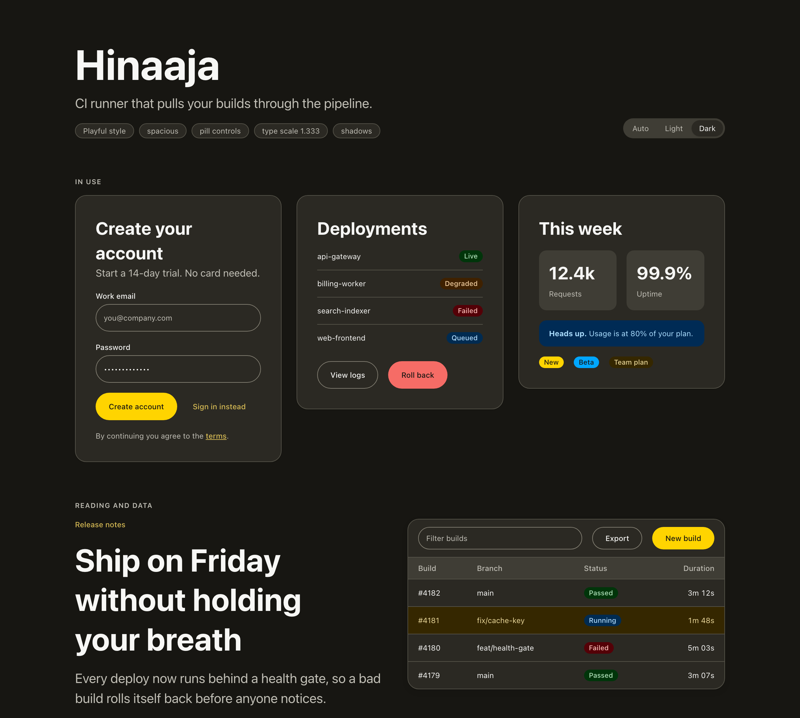

# Kaava

[](https://www.npmjs.com/package/kaava-mcp)
[](https://github.com/randomikko/kaava-mcp/actions/workflows/ci.yml)
[](LICENSE)

**An MCP server that gives your coding agent a real design system.**

Agents are good at taste and bad at color math. Left alone they invent a new shade of blue in every file, pick greys that fail contrast, and drift between turns. Kaava (Finnish for *formula*) splits the work:

- **The agent supplies the brief**: a brand color and a style.
- **A style supplies the character**: ramp shape, typography, spacing rhythm, corners, elevation and motion, authored by a person and stored as a file.
- **Kaava supplies the formula**: OKLCH color ramps, light and dark semantic roles that are contrast-checked, a modular type scale, spacing, radii, shadows and motion. Deterministic: the same brief always produces the same system.

The result is one `kaava.json` in your repo, emitted as CSS variables, a Tailwind v4 theme, a shadcn/ui theme, SCSS, TypeScript, W3C design tokens, and a `DESIGN.md` that tells the next agent session how to use it.

**Works with:** [Tailwind CSS v4](https://tailwindcss.com/docs/theme) · [shadcn/ui](https://ui.shadcn.com/docs/theming) · [CSS custom properties](https://developer.mozilla.org/en-US/docs/Web/CSS/Using_CSS_custom_properties) · [Sass](https://sass-lang.com) · [TypeScript](https://www.typescriptlang.org) · [W3C design tokens](https://www.designtokens.org/) (Figma plugins, [Style Dictionary](https://styledictionary.com)) · [DESIGN.md](https://github.com/google-labs-code/design.md). Details in [Output formats](#output-formats).

No API keys, no network calls, no LLM inside the server.

| [Ahtaaja](https://randomikko.github.io/kaava-mcp/ahtaaja/kaava/preview.html#light): `#4f46e5`, friendly | [Hinaaja](https://randomikko.github.io/kaava-mcp/hinaaja/kaava/preview.html#dark): `#ffd400`, playful, dark |
|---|---|
| [](https://randomikko.github.io/kaava-mcp/ahtaaja/kaava/preview.html#light) | [](https://randomikko.github.io/kaava-mcp/hinaaja/kaava/preview.html#dark) |

Both pages are `preview.html` as emitted by Kaava from a two-field brief: a brand color and a style. **[Open the live examples](https://randomikko.github.io/kaava-mcp/)**, or browse every generated file in [`examples/`](examples). The example names are Finnish too: *ahtaaja* is a stevedore, *hinaaja* a tugboat.

## Install

Claude Code:

```sh
claude mcp add kaava -- npx -y kaava-mcp
```

Cursor, VS Code, Claude Desktop and other MCP clients:

```json
{
  "mcpServers": {
    "kaava": { "command": "npx", "args": ["-y", "kaava-mcp"] }
  }
}
```

Requires Node 20 or newer.

## Use

Ask your agent:

> Set up a design system for this app with Kaava. Brand color is #4f46e5, friendly feel.

or run the built-in `new-design-system` prompt, which has the agent inspect the project, ask what it cannot infer, generate the system and wire it in.

What happens:

1. `kaava_create_system` writes `kaava.json` and reports contrast.
2. `kaava_emit` writes the outputs for your stack into `kaava/` (or a directory you choose).
3. The agent reads `DESIGN.md` and builds UI from tokens instead of hard-coded values.
4. Later, "make the corners rounder" or "the dark primary is too dull" becomes a `kaava_update_system` call, and every emitted file is regenerated.

## Command line

The same tools work without an MCP client. Run a command in the project directory:

```sh
npx kaava-mcp init --brand "#4f46e5" --style friendly
```

That writes `kaava.json` plus `tokens.css`, `DESIGN.md` and `preview.html` into `kaava/`.

| Command | What it does |
|---|---|
| `init --brand <color> [brief options]` | Create the system and write the outputs. `--targets tailwind,design-md` and `--out src/styles` choose what goes where. |
| `update [brief options] [--set <token>=<value>] [--unset <token>]` | Change the brief or override single tokens. Regenerates the outputs. |
| `emit <target>...` | Write more outputs: `css`, `tailwind`, `shadcn`, `scss`, `ts`, `dtcg`, `design-md`, `preview`. |
| `tokens [<path>]` | List token groups, or the tokens under a path such as `color` or `font.size`. |
| `audit` | Accessibility audit. Exits 1 when something fails, so it can gate CI. |
| `contrast <foreground> <background>` | Check two colors or tokens. Exits 1 when the pair fails. |
| `styles` | List the available styles. |

Each field of [the brief](#the-brief) has an option: `--style`, `--accent`, `--density`, `--radius`, `--type-scale`, `--neutral-tint`, `--shadows`, `--font-sans`, `--font-mono`, `--font-display`, `--no-dark`. `--project <dir>` works on another directory and `--dry-run` shows what would be written. `npx kaava-mcp --help` lists everything.

Without a command, `kaava-mcp` runs as the MCP server.

## Tools

| Tool | What it does |
|---|---|
| `kaava_create_system` | Brief → full design system saved to `kaava.json`. Only `brandColor` is required. |
| `kaava_update_system` | Patch the brief, or override single tokens. Regenerates emitted files. |
| `kaava_get_tokens` | Look up tokens by path (`color`, `font.size`, `palette.primary`, …). |
| `kaava_emit` | Write `css`, `tailwind`, `shadcn`, `scss`, `ts`, `dtcg`, `design-md`, `preview` outputs. |
| `kaava_audit` | Accessibility audit against WCAG 2.2 AA: every promised color pairing (with APCA values), fill boundaries, status colors under color-vision deficiencies, target sizes. |
| `kaava_check_contrast` | Check any two colors or tokens against WCAG 2.2; when the pair fails, get the nearest passing color and the system text colors that do pass. |

Resources: `kaava://system` (the current `kaava.json`) and `kaava://styles` (every style, its author and each decision it makes).

### The brief

| Field | Values | Default |
|---|---|---|
| `brandColor` | any CSS color | required |
| `accent` | any CSS color | derived from the brand hue |
| `style` | `minimal`, `friendly`, `corporate`, `playful`, `editorial`, `technical` | `default` |
| `density` | `compact`, `comfortable`, `spacious` | from style |
| `radius` | `none`, `sm`, `md`, `lg`, `full` | from style |
| `typeScale` | 1.067 – 1.5 | from style |
| `neutralTint` | 0 – 1, how much brand hue the greys carry | from style |
| `shadows` | `none`, `soft`, `crisp` | from style |
| `fonts` | `{ sans, mono, display }` | from style |
| `darkMode` | boolean | `true` |

Explicit fields win over the style: each one swaps a single aspect of it for a generic version, so leave them out to keep the style as designed.

### Styles

A style is one JSON file in [`styles/`](styles) holding every decision that gives a system its character, independent of brand color: the lightness and chroma curve of the color ramps, which steps are page and surface, status hues, type families and web fonts, each type size with its line height and letter-spacing, control heights and spacing rhythm per density, the radius scale, border width, shadow layers, durations and easings. Each file names its author.

Styles are designed in the workbench, a local page with a control for every value and a live preview rendered by the real engine:

```sh
npm run workbench   # http://127.0.0.1:4174
```

It shows the style against several brand colors at once, with a contrast verdict for each, because a style has to hold for any color a brief brings. The family fields autocomplete every Google Fonts family, and a searchable list shows each one in its own typeface; choosing one adds its stylesheet to the style. Saving writes `styles/<id>.json`; the test suite then checks the new style against WCAG 2.2 AA across 102 brand colors.

The built-in styles are generic starting points. Duplicate one and make it yours.

### Overrides

When a derived value is not what you want, override the token rather than editing files:

```json
{
  "overrides": {
    "radius.control": "{radius.full}",
    "font.size.base": "1.0625rem",
    "dark:color.primary": "#8b9cff"
  }
}
```

Keys are token paths; prefix semantic colors with `light:` or `dark:` to target one theme. Values are CSS values or `{references}` to other tokens. Overrides survive brief changes, and `kaava_audit` tells you if one broke contrast.

## What you get

**Color.** Seven 11-step ramps (neutral, primary, accent, success, warning, danger, info) with identical lightness per step, plus semantic roles for light and dark: `bg`, `surface`, `surface-muted`, `fg`, `fg-muted`, `border`, `border-strong`, `ring`, and for each of primary / accent / status: the fill, its hover, `on-*` text, a `*-subtle` tint, `on-*-subtle` text and `*-text` for colored text on surfaces. Your exact brand color is the primary fill. Text roles are chosen by searching the ramp for the first step that reaches 4.5:1 on every surface it is promised for, so the pairings hold for any brand color.

**Type.** Nine sizes on a modular scale with matched line heights, four weights, sans / mono / display families.

**Space and shape.** A 4px spacing scale, semantic spacing (`gap`, `inset`, `section`, `control`), control heights, a radius scale with `control` and `surface` aliases, three shadow levels, durations and easings.

**Accessibility.** Every promised text and UI pairing meets WCAG 2.2 AA for any brand color, and the test suite sweeps 102 brand colors across all styles to keep it that way. `kaava_audit` also reports what tokens alone cannot guarantee: fills too faint to mark a button's edge, status colors that look alike with protanopia, deuteranopia or tritanopia, and controls under 24px. `kaava_check_contrast` covers any pairing you add yourself. The emitted stylesheets honor `prefers-reduced-motion`. Kaava audits the tokens, not rendered pages: run a tool such as axe on the built UI for markup, labels and focus order.

### Output formats

| Target | File | Use it when |
|---|---|---|
| `css` | `tokens.css` | You use any framework, or none. Custom properties on `:root`; dark mode follows the OS, or force it with `data-theme="dark"` / `.dark`. |
| `tailwind` | `tailwind.css` | You use [Tailwind v4](https://tailwindcss.com/docs/theme). `@theme` variables in Tailwind's namespaces, so you get `bg-surface`, `text-fg-muted`, `rounded-control`, `p-inset`. |
| `shadcn` | `shadcn.css` | You use [shadcn/ui](https://ui.shadcn.com/docs/theming). The `:root`, `.dark` and `@theme inline` blocks its components read (`--background`, `--primary`, `--ring`, `--radius`, charts, sidebar), in OKLCH. Run `npx shadcn@latest init`, then replace those blocks in `globals.css` with this file's. |
| `scss` | `_tokens.scss` | You use [Sass](https://sass-lang.com). Sass variables plus the custom properties. |
| `ts` | `tokens.ts` | You style from [TypeScript](https://www.typescriptlang.org): typed objects of resolved values for React, Vue, Svelte, React Native, charts. |
| `dtcg` | `tokens.json`, `tokens.dark.json` | You feed design tools or a pipeline: the [W3C Design Tokens](https://www.designtokens.org/) format, read by Figma plugins and [Style Dictionary](https://styledictionary.com). |
| `design-md` | `DESIGN.md` | You want your agent to follow the system: tokens as YAML front matter, usage rules and the full role table, in the [DESIGN.md format](https://github.com/google-labs-code/design.md). Check it with `npx @google/design.md lint kaava/DESIGN.md`. |
| `preview` | `preview.html` | You want to see it: a self-contained page showing the system in use, with every role, ramp and scale. Open it in a browser; add `#dark` or `#light` to force a theme. |

Kaava emits the files and variables each system reads. It does not install or configure those systems for you, and the shadcn output has not yet been compared with a fresh `shadcn init` on a real project.

## Notes

- Kaava writes only inside the project root: the workspace root your MCP client exposes, or the directory the server starts in. Every writing tool accepts `dryRun`.
- `kaava.json` and the emitted files are generated. Change them through the tools; hand edits are overwritten on the next update.
- `kaava_create_system` refuses to replace an existing system unless you pass `overwrite: true`.
- `kaava_emit` never replaces a file it did not generate (your own `tokens.css`, say) unless you pass `overwrite: true`, and it does not follow symlinks out of the project.

## Roadmap

- **Next targets**: a [MUI](https://mui.com/material-ui/customization/theming/) `createTheme` output.
- **0.2** Components: framework-neutral specs and shared styles with thin React, Vue, Svelte and HTML wrappers; scanning code for hard-coded values.
- **0.3** Import an existing system from CSS variables, Tailwind config or DTCG files.
- **0.4** Import from Figma and Storybook.

## Programmatic use

```ts
import { buildSystem, renderTargets } from 'kaava-mcp';

const system = buildSystem({ brandColor: '#4f46e5', style: 'friendly' });
const files = renderTargets(system, ['css', 'design-md']);
```

## Development

```sh
npm install
npm test          # engine, emitters, and an in-memory MCP client end to end
npm run build
npm run inspect   # open the MCP Inspector against the built server
npm run workbench # design styles with a live preview
npm run examples  # regenerate examples/ after a change to generated output
```

## License

MIT © Mikko Grönlund
