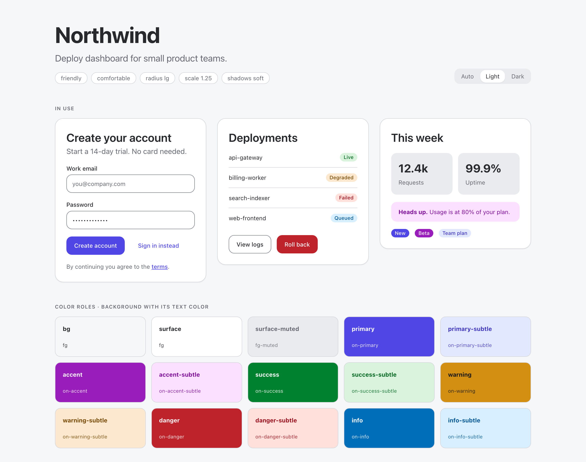

# Kaava

[](https://www.npmjs.com/package/kaava-mcp)
[](https://github.com/randomikko/kaava-mcp/actions/workflows/ci.yml)
[](LICENSE)

**An MCP server that gives your coding agent a real design system.**

Agents are good at taste and bad at color math. Left alone they invent a new shade of blue in every file, pick greys that fail contrast, and drift between turns. Kaava (Finnish for *formula*) splits the work:

- **The agent supplies the taste**: a brand color, a mood, how dense the UI should feel.
- **Kaava supplies the formula**: OKLCH color ramps, light and dark semantic roles that are contrast-checked, a modular type scale, spacing, radii, shadows and motion. Deterministic: the same brief always produces the same system.

The result is one `kaava.json` in your repo, emitted as CSS variables, a Tailwind v4 theme, SCSS, TypeScript, W3C design tokens, and a `DESIGN.md` that tells the next agent session how to use it.

No API keys, no network calls, no LLM inside the server.

| `#4f46e5`, friendly | `#ffd400`, playful, dark |
|---|---|
|  |  |

Both pages above are `preview.html` as emitted by Kaava from a two-field brief: a brand color and a mood.

## Install

Claude Code:

```sh
claude mcp add kaava -- npx -y kaava-mcp
```

Cursor, VS Code, Claude Desktop and other MCP clients:

```json
{
  "mcpServers": {
    "kaava": { "command": "npx", "args": ["-y", "kaava-mcp"] }
  }
}
```

Requires Node 20 or newer.

## Use

Ask your agent:

> Set up a design system for this app with Kaava. Brand color is #4f46e5, friendly feel.

or run the built-in `new-design-system` prompt, which has the agent inspect the project, ask what it cannot infer, generate the system and wire it in.

What happens:

1. `kaava_create_system` writes `kaava.json` and reports contrast.
2. `kaava_emit` writes the outputs for your stack into `kaava/` (or a directory you choose).
3. The agent reads `DESIGN.md` and builds UI from tokens instead of hard-coded values.
4. Later, "make the corners rounder" or "the dark primary is too dull" becomes a `kaava_update_system` call, and every emitted file is regenerated.

## Tools

| Tool | What it does |
|---|---|
| `kaava_create_system` | Brief → full design system saved to `kaava.json`. Only `brandColor` is required. |
| `kaava_update_system` | Patch the brief, or override single tokens. Regenerates emitted files. |
| `kaava_get_tokens` | Look up tokens by path (`color`, `font.size`, `palette.primary`, …). |
| `kaava_emit` | Write `css`, `tailwind`, `scss`, `ts`, `dtcg`, `design-md`, `preview` outputs. |
| `kaava_audit` | Accessibility audit against WCAG 2.2 AA: every promised color pairing (with APCA values), fill boundaries, status colors under color-vision deficiencies, target sizes. |
| `kaava_check_contrast` | Check any two colors or tokens against WCAG 2.2; when the pair fails, get the nearest passing color and the system text colors that do pass. |

Resources: `kaava://system` (the current `kaava.json`) and `kaava://presets` (the moods).

### The brief

| Field | Values | Default |
|---|---|---|
| `brandColor` | any CSS color | required |
| `accent` | any CSS color | derived from the brand hue |
| `mood` | `minimal`, `friendly`, `corporate`, `playful`, `editorial`, `technical` | balanced |
| `density` | `compact`, `comfortable`, `spacious` | from mood |
| `radius` | `none`, `sm`, `md`, `lg`, `full` | from mood |
| `typeScale` | 1.067 – 1.5 | from mood |
| `neutralTint` | 0 – 1, how much brand hue the greys carry | from mood |
| `shadows` | `none`, `soft`, `crisp` | from mood |
| `fonts` | `{ sans, mono, display }` | system stacks |
| `darkMode` | boolean | `true` |

Explicit fields always win over the mood.

### Overrides

When a derived value is not what you want, override the token rather than editing files:

```json
{
  "overrides": {
    "radius.control": "{radius.full}",
    "font.size.base": "1.0625rem",
    "dark:color.primary": "#8b9cff"
  }
}
```

Keys are token paths; prefix semantic colors with `light:` or `dark:` to target one theme. Values are CSS values or `{references}` to other tokens. Overrides survive brief changes, and `kaava_audit` tells you if one broke contrast.

## What you get

**Color.** Seven 11-step ramps (neutral, primary, accent, success, warning, danger, info) with identical lightness per step, plus semantic roles for light and dark: `bg`, `surface`, `surface-muted`, `fg`, `fg-muted`, `border`, `border-strong`, `ring`, and for each of primary / accent / status: the fill, its hover, `on-*` text, a `*-subtle` tint, `on-*-subtle` text and `*-text` for colored text on surfaces. Your exact brand color is the primary fill. Text roles are chosen by searching the ramp for the first step that reaches 4.5:1 on every surface it is promised for, so the pairings hold for any brand color.

**Type.** Nine sizes on a modular scale with matched line heights, four weights, sans / mono / display families.

**Space and shape.** A 4px spacing scale, semantic spacing (`gap`, `inset`, `section`, `control`), control heights, a radius scale with `control` and `surface` aliases, three shadow levels, durations and easings.

**Accessibility.** Every promised text and UI pairing meets WCAG 2.2 AA for any brand color, and the test suite sweeps 102 brand colors across all moods to keep it that way. `kaava_audit` also reports what tokens alone cannot guarantee: fills too faint to mark a button's edge, status colors that look alike with protanopia, deuteranopia or tritanopia, and controls under 24px. `kaava_check_contrast` covers any pairing you add yourself. The emitted stylesheets honor `prefers-reduced-motion`. Kaava audits the tokens, not rendered pages: run a tool such as axe on the built UI for markup, labels and focus order.

### Output formats

| Target | File | For |
|---|---|---|
| `css` | `tokens.css` | Any framework. Custom properties on `:root`; dark mode follows the OS, or force it with `data-theme="dark"` / `.dark`. |
| `tailwind` | `tailwind.css` | Tailwind v4. `@theme` variables in Tailwind's namespaces, so you get `bg-surface`, `text-fg-muted`, `rounded-control`, `p-inset`. |
| `scss` | `_tokens.scss` | Sass variables plus the custom properties. |
| `ts` | `tokens.ts` | Typed objects of resolved values for React, Vue, Svelte, React Native, charts. |
| `dtcg` | `tokens.json`, `tokens.dark.json` | W3C Design Tokens format for Figma plugins and Style Dictionary. |
| `design-md` | `DESIGN.md` | Usage rules and the full role table, for agents and people. |
| `preview` | `preview.html` | A self-contained page showing the system in use, with every role, ramp and scale. Open it in a browser; add `#dark` or `#light` to force a theme. |

## Notes

- Kaava writes only inside the project root: the workspace root your MCP client exposes, or the directory the server starts in. Every writing tool accepts `dryRun`.
- `kaava.json` and the emitted files are generated. Change them through the tools; hand edits are overwritten on the next update.
- `kaava_create_system` refuses to replace an existing system unless you pass `overwrite: true`.
- `kaava_emit` never replaces a file it did not generate (your own `tokens.css`, say) unless you pass `overwrite: true`, and it does not follow symlinks out of the project.

## Roadmap

- **0.2** Components: framework-neutral specs and shared styles with thin React, Vue, Svelte and HTML wrappers; scanning code for hard-coded values.
- **0.3** Import an existing system from CSS variables, Tailwind config or DTCG files.
- **0.4** Import from Figma and Storybook.

## Programmatic use

```ts
import { buildSystem, renderTargets } from 'kaava-mcp';

const system = buildSystem({ brandColor: '#4f46e5', mood: 'friendly' });
const files = renderTargets(system, ['css', 'design-md']);
```

## Development

```sh
npm install
npm test          # engine, emitters, and an in-memory MCP client end to end
npm run build
npm run inspect   # open the MCP Inspector against the built server
```

## License

MIT © Mikko Grönlund
